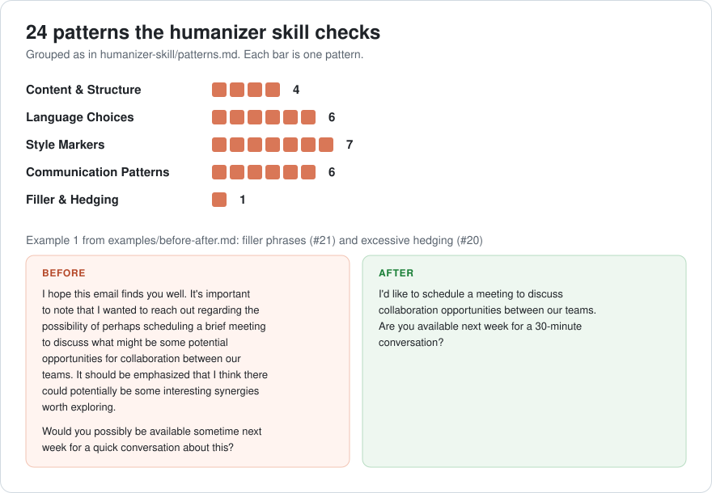

# AI Writing Patterns

Catch 24 documented AI writing patterns so your writing still sounds like you.

**Who this is for:** writers, editors, and teams who draft with AI and want their own voice in the final copy.

[](LICENSE)
[](https://claude.com/claude-code)
[](https://github.com/marianasmall/ref-ai-writing-patterns/commits/main)

A methodology and toolkit for detecting AI writing patterns and maintaining authentic voice when working with language models.

### What it looks like



*The five pattern categories with their counts, and one real before/after pair from the [examples](examples/before-after.md).*

## What This Is

When you work with AI writing tools, your content can inadvertently pick up characteristic patterns: mechanical phrases, formulaic structures, and performative language that signal "this was written by AI." This project provides:

1. **A methodology** for evaluating whether your writing voice prevents common AI patterns
2. **A detection skill** for Claude that catches 24 documented AI writing patterns
3. **Integration guidance** for adapting these tools to your own voice and needs

## Why This Matters

AI writing assistants are useful tools, but maintaining authentic voice requires intentional effort. Generic AI outputs often exhibit patterns like:

- Surface-level descriptive verbs ("symbolizing," "reflecting")
- Weak verb substitutions ("serves as" instead of "is")
- Formulaic triplets (rule of three)
- Vapid closings with generic optimism
- Hedging language and unnecessary qualifiers

These patterns make content feel mechanical and templated, even when the underlying ideas are solid.

## What's Included

### Methodology
**[Gap Analysis Framework](methodology/gap-analysis.md)**: A systematic approach for evaluating any writing guide against known AI writing patterns. Shows how to identify gaps, prioritize coverage, and integrate pattern detection into your workflow.

### Tools
**[Humanizer Skill](humanizer-skill/)**: A Claude skill that detects 24 AI writing patterns documented in Wikipedia's "Signs of AI Writing" guide. Works in Claude.ai, Claude Code, and via API.

**[Pattern Reference](humanizer-skill/patterns.md)**: Detailed explanations of all 24 patterns with examples, organized by category (Content, Language, Style, Communication, Filler/Hedging).

### Documentation
**[Installation Guide](docs/installation.md)**: How to add the humanizer skill to Claude.

**[Integration Guide](docs/integration.md)**: How to adapt the methodology for your own writing voice and use cases.

**[Examples](examples/before-after.md)**: Before/after examples showing patterns and how to fix them.

## Quick Start

**Install the skill in Claude Code in 3 steps** (from the [Installation Guide](docs/installation.md), Option 2):

1. Make a folder for the skill:
   ```bash
   mkdir -p ~/.claude/skills/humanizer
   ```
2. Download the skill file into it:
   ```bash
   curl -o ~/.claude/skills/humanizer/SKILL.md \
     https://raw.githubusercontent.com/marianasmall/ref-ai-writing-patterns/main/humanizer-skill/SKILL.md
   ```
3. Start `claude` and ask it to check a draft:
   ```text
   Check this file for AI patterns: draft.md
   ```

Using Claude.ai or the API instead? See Options 1 and 3 in the [Installation Guide](docs/installation.md).

**Then go deeper:**

1. Read the [methodology](methodology/gap-analysis.md) to understand the approach
2. Install the [humanizer skill](humanizer-skill/) in Claude
3. Use the [pattern reference](humanizer-skill/patterns.md) to understand what gets flagged
4. Follow the [integration guide](docs/integration.md) to customize for your needs

## Background

This project emerged from analyzing the gap between a strong writing voice guide and AI pattern detection tools. The core insight: **strong foundational writing principles prevent most AI patterns naturally**. The patterns that slip through are edge cases that benefit from explicit detection.

The 24 patterns come from Wikipedia's "Signs of AI Writing" article, maintained by WikiProject AI Cleanup. The methodology was developed through practical application of evaluating voice guides against these patterns.

## Use Cases

- **Content creators** who use AI writing tools but want to maintain authentic voice
- **Editors** who need to identify and fix AI-generated patterns in content
- **Writers** developing their own voice guidelines and want to ensure AI-resistance
- **Teams** establishing writing standards that work well with AI assistance

## Credits

Pattern list sourced from Wikipedia's "Signs of AI Writing" (WikiProject AI Cleanup).

Inspired by [Siqi Chen's humanizer skill](https://github.com/blader/humanizer).

## License

MIT License. See the [LICENSE](LICENSE) file for details.

## Contributing

Issues and pull requests welcome. This is a living project that benefits from real-world usage and feedback.
